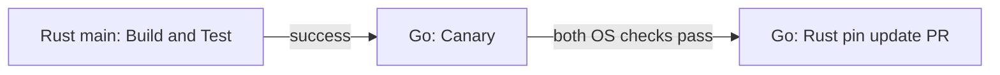
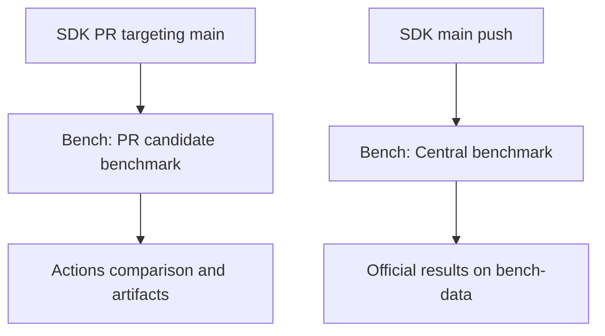
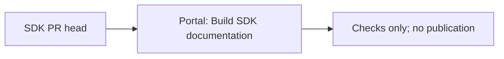
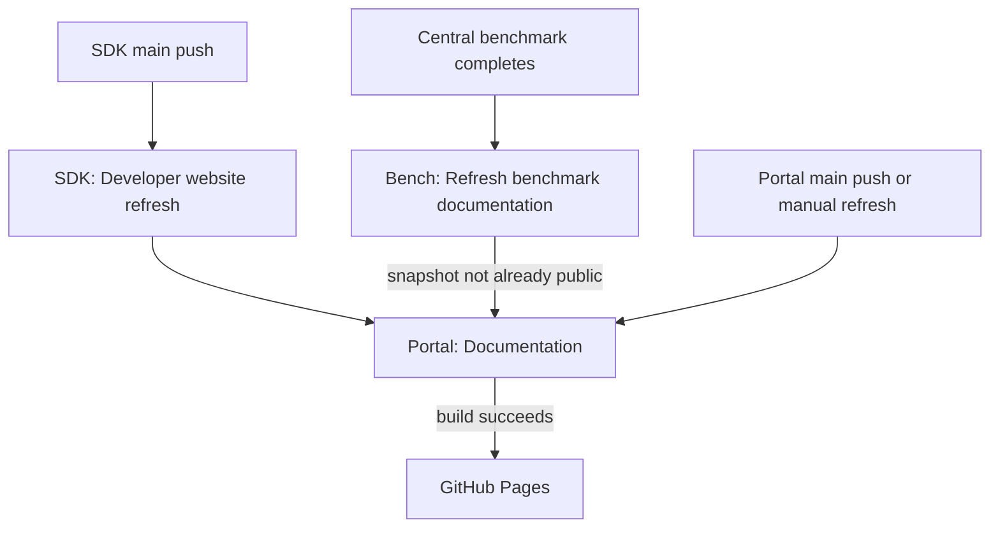

# Repository workflows

Qortoo separates SDK validation, performance measurements, and documentation
publication. This guide maps the repositories and the workflows connecting them.
Automatic paths below apply only to changes selected by each workflow's filters.

## Repository roles

| Repository | Responsibility |
| --- | --- |
| `qortoo-harness` | Shared development tools, repository catalog, and agent policies. |
| `qortoo-rs` | Rust core, C ABI/native SDK, Rust guides, and functional validation. |
| `qortoo-go` | Go bindings, Go guides, and compatibility with the native SDK. |
| `qortoo-bench` | Benchmark workloads, official/PR measurements, and result storage. |
| `qortoo` | Combined SDK guides/APIs, Performance display, and GitHub Pages publication. |

SDKs own their documentation content. This repository owns its collection,
presentation, and deployment; benchmark contracts and operations belong to Bench.

## Native SDK compatibility

The SDK's **Go binding canary** requests Go **Canary** after a successful Rust
main build. Canary uses an optional Rust SHA or resolves main once, tests that
same revision on Linux/macOS, and proposes a pin PR. It does not merge the PR.

## Performance measurements

PR measurements pass through **Benchmark PR event** and **Central PR benchmark
request** before reaching Bench. SDK main measurements use **Central benchmark
request**. A PR can produce multiple candidate runs as its head changes and a
separate official request when it merges; these are different measurements.

| Measurement | Outcome |
| --- | --- |
| PR candidate | Base/head comparison in the Actions summary and 30-day artifacts; no official data publication. |
| Main | Exact push SHA and resolved dependencies recorded in `bench-data`; successful official results feed Performance. |

See [Bench Performance](https://github.com/qortoo/qortoo-bench/blob/main/docs/performance.md)
for execution and result details.

## SDK documentation and publication

SDK **Developer website** workflows validate documentation/API changes on PRs
and request publication after matching changes reach main. PR and main use the
same filters; a PR with relevant changes can be checked again after an unrelated
commit. Manual main refresh remains available outside those filters.

| Event | SDK job | Result |
| --- | --- | --- |
| Matching SDK PR | `validate` | Shared builder checks the exact head, including forks; no publication. |
| Matching official SDK main push | `refresh` | Requests portal **Documentation** on main. |
| Manual SDK main run | `refresh` | Requests fresh default revisions. |
| Manual SDK run on another branch/repository | Neither | No refresh request. |

### PR validation

The portal's own PRs also run **Documentation** for validation without publishing.
Manual SDK candidate checks likewise do not deploy.

The shared [builder](../.github/workflows/build-docs.yml) resolves immutable site
and SDK revisions, then checks guides, APIs, fixtures, types, links, and the build
manifest. Rust API generation can run build scripts; candidate jobs therefore
have read-only permissions, no inherited secrets, and no deployment credentials.
Go API extraction does not compile cgo. Both guide and API output use the same
SDK revision. A candidate check can also fail because of the shared builder or
the other SDK's default revision; inspect the selected inputs first.

### Publication

Bench refreshes after failures as well as successes so request status can change
without replacing successful measurements. Automatic refresh skips an already
public snapshot; lookup failures still request refresh, and manual refresh always
requests a rebuild. This does not rerun benchmarks.

The SDK refresh job executes no SDK code. Its `WORKFLOW_PAT` needs Actions write
access to `qortoo/qortoo`. Configure it for both SDK repositories and keep it out
of PR validation. The SDK token does not need Pages permissions; deployment uses
the portal's own job credentials.
A refresh resolves the latest configured SDK refs when it runs, so it may include
commits newer than the triggering event. Once resolved, those SHAs remain fixed.

Only a successful non-candidate portal main push/manual run uploads a Pages
artifact. The separate deployment job uses the `github-pages` environment and
Pages/OIDC permissions, then compares the public
[revision manifest](https://qortoo.github.io/qortoo/generated/sources.json)
with the build inputs. A failed verification reports a mismatch after deployment;
it does not roll back the site.

### Recovery

| Situation | Next step |
| --- | --- |
| Candidate check fails | Fix the reported input and push the PR again; nothing was published. |
| SDK dispatch fails | Fix token access, then run **Developer website** on SDK main. |
| Website build fails | Fix the source or builder and start a new **Documentation** run. |
| Deployment/manifest verification fails | Inspect the live manifest and deployment before correcting or republishing. |

A new workflow run resolves fresh defaults; rerunning only a build job uses its
existing inputs. Manual portal **Documentation** with candidate SDK `none` requests
publication. With `rust` or `go`, a repository and full SHA select a non-publishing
candidate check. New publication runs cancel older publications for the same ref;
manual candidate checks use separate concurrency groups.

The event filters and candidate inputs are defined in the
[Rust caller](https://github.com/qortoo/qortoo-rs/blob/main/.github/workflows/developer-site.yml)
and [Go caller](https://github.com/qortoo/qortoo-go/blob/main/.github/workflows/developer-site.yml).
Only the portal [Documentation workflow](../.github/workflows/docs.yml) deploys.

## Inputs and trust boundaries

- SDK documentation candidates use the exact PR head, including fork heads.
  Guides and API references for an SDK share the same resolved SHA.
- Official benchmarks retain the original main push SHA and resolved dependencies.
  PR measurements authenticate their source run and freeze base/head inputs.
- PR code receives no dispatch or publication secret. The separate trusted PR
  benchmark notifier reads API metadata without executing candidate code.
- Dispatch acceptance is not completion. Follow the receiving run; for website
  publication, check deployment and its public revision-manifest verification.

## Detailed guides

- [Developer site](developer-site.md) and [benchmark display](benchmark-results.md):
  local website work, collection, and deployment.
- [Bench Performance](https://github.com/qortoo/qortoo-bench/blob/main/docs/performance.md):
  measurement workflows, result locations, and run/recovery guides.
- [Rust Canary caller](https://github.com/qortoo/qortoo-rs/blob/main/.github/workflows/go-canary.yml)
  and [Go Canary](https://github.com/qortoo/qortoo-go/blob/main/.github/workflows/canary.yml):
  trigger and tested native-SDK pin update.
