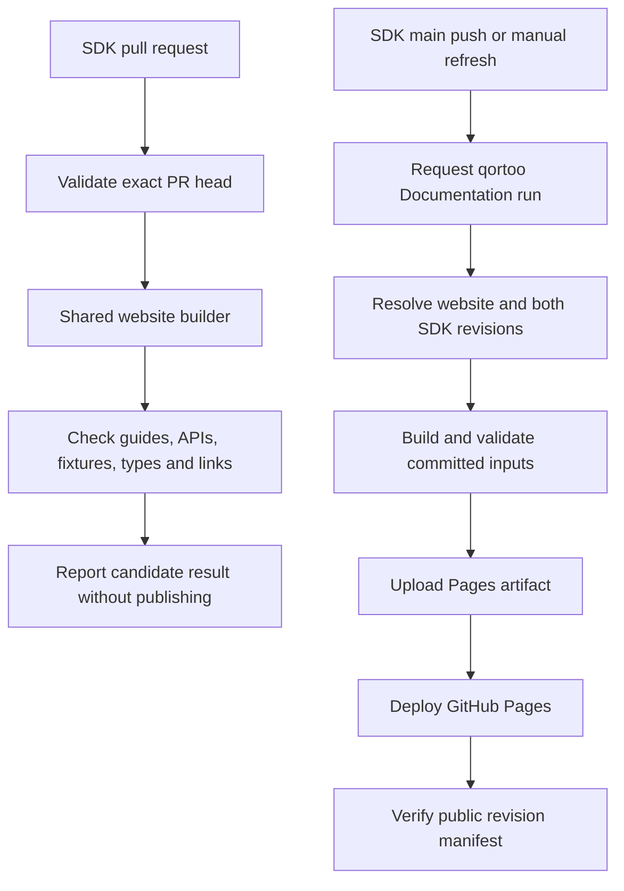

# SDK documentation workflows

The Rust and Go SDKs own their guides and API comments. Their **Developer website**
workflows validate proposed changes and request publication after changes reach
`main`. The `qortoo` repository owns the shared builder and GitHub Pages deployment.
This document covers that documentation pipeline; SDK runtime tests, benchmarks,
and Canary workflows have their own responsibilities.

## Model

SDK callers use the shared workflow at `qortoo/qortoo/.../build-docs.yml@main`.
The resolver selects one website commit and one commit for each SDK. Subsequent
collection, API generation, and export use those immutable revisions. Guides and
API references for an SDK must use the same SHA.

The shared workflow definition follows `main`; it is not pinned permanently to a
release. Each build records the website checkout and SDK revisions it actually uses.

## SDK events and jobs

Both SDKs use `.github/workflows/developer-site.yml`, with the following behavior:

| Event | `validate` | `refresh` | Publication |
| --- | --- | --- | --- |
| Pull request targeting `main` | Build the exact PR head, including fork heads | Skipped | None |
| Matching path pushed to official SDK `main` | Skipped | Request website run | Separate website run |
| Manual SDK run on official `main` | Skipped | Request website run | Separate website run |
| Manual SDK run on another branch or repository | Skipped | Skipped | None |

PR validation has no path filter. A new run for the same PR ref cancels its older
in-progress run. Main refresh requests use a separate ref from PR validation.

The push filters reflect each SDK's documentation and API inputs:

| SDK | Paths that request a refresh on `main` |
| --- | --- |
| Rust | `docs/**`, `src/**`, `Cargo.toml`, `Cargo.lock`, `build.rs`, `examples/**`, `tests/**`, `scripts/**`, `qortoo-ffi/**`, `.github/workflows/developer-site.yml` |
| Go | `docs/**`, `**/*.go`, `go.mod`, `go.sum`, `examples/**`, `scripts/**`, `.github/workflows/developer-site.yml` |

A push changing only root `README.md` or `CONTRIBUTING.md` does not request a
refresh. Use a manual run when publication is needed outside these filters.
There is no scheduled polling or automatic retry after a failed request.

### Candidate validation

The caller supplies `candidate_sdk` (`rust` or `go`), the PR head repository, and
its full commit SHA. The resolver checks that these inputs match the caller and
originating PR event. The other SDK uses the default ref in
[`docs-sources.json`](../docs-sources.json).

The shared `resolve` job fixes the inputs, then the `build` job checks them out.
The build runs `npm ci`, transformation tests, the asset fixture build, the normal
website build, type checks, exported-link checks, and an exact-input manifest check.
Rust API generation runs `cargo doc --locked --no-deps -p qortoo --all-features`.
Go API extraction parses exported declarations without compiling cgo or loading
native SDK libraries. See [API references](developer-site.md#api-references).

These checks validate documentation generation. They do not replace SDK runtime
tests. A broken shared website or a broken default revision of the other SDK can
also fail a candidate run; inspect the resolved inputs before attributing a failure
to the PR.

### Main refresh

The `refresh` job runs only in the official SDK repository on `main`, for a push or
manual dispatch. It checks for `WORKFLOW_PAT`, then requests
`qortoo/qortoo`'s `docs.yml` on `main` with `candidate_sdk: none`. It does not check
out or execute SDK code.

The request does not pin publication to the triggering SDK commit. The website
resolves both SDK default refs when its resolver runs, so a newer merged commit
can be included. Each ref is resolved separately; this is not an atomic snapshot
of all three repositories. Once resolved, the build uses those fixed SHAs.

A successful `refresh` job confirms that GitHub accepted the request. The website
build and deployment can still fail. Follow the website run URL when logged, or
inspect the website's **Documentation** runs and their input summaries.

## Permissions and publication rules

Candidate jobs have `contents: read`, use checkouts with persisted credentials
disabled, and receive no inherited SDK secrets. Candidate Rust build scripts can
execute during API generation, so these jobs run on GitHub-hosted runners without
deployment credentials. They use `pull_request`, not `pull_request_target`.

The SDK `refresh` job sets `permissions: {}` for `GITHUB_TOKEN` and authenticates
the dispatch with `WORKFLOW_PAT`. Configure that secret in both SDK repositories,
or expose an organization secret to those two repositories. The token needs
**Actions: read and write** on the target repository, `qortoo/qortoo`.
The required target permission is defined by GitHub's
[workflow dispatch API](https://docs.github.com/en/rest/actions/workflows#create-a-workflow-dispatch-event).
Dispatch alone does not require Contents write or Pages permissions. If reusing
the Go Canary token, preserve its Contents and Workflows write permissions on
`qortoo/qortoo-go`. See [credential setup](developer-site.md#automatic-updates-and-recovery).

The shared builder uploads a Pages artifact only when explicitly requested by a
non-candidate push or manual run on `qortoo/qortoo`'s `main`. SDK PR callers leave
`upload_pages` at its default of `false`. The separate website deployment job
repeats the repository, branch, event, candidate, and successful-build guards.
Only that job requests `pages: write` and `id-token: write` and uses the
`github-pages` environment. Generated HTML is published as an artifact, not committed.

## Verification and recovery

The website records resolved inputs in its job summary and exports
`out/generated/sources.json`. The public copy is
[`/qortoo/generated/sources.json`](https://qortoo.github.io/qortoo/generated/sources.json).
Check `mode: committed`, `site.dirty: false`, the website SHA, both SDK repositories
and guide SHAs, and each corresponding API SHA. Automation metadata links the
manifest to its Actions run.

After deployment, the website checks these public fields against the validated
inputs, retrying up to six times while the publication becomes visible.

| Failure or outcome | Meaning and recovery |
| --- | --- |
| Candidate validation fails | No publication occurs. Inspect `validate / resolve` or `validate / build`, fix the candidate, and push again. |
| Missing token or rejected dispatch | No website run is successfully requested by that attempt. Fix the secret/access, then manually run the SDK workflow on `main`. |
| Website build fails | Deployment is skipped and the existing public site remains. Fix the reported source or builder issue, then request a fresh website run. |
| Deployment fails or is canceled | Inspect the deployment and public manifest to establish what is live before retrying. |
| Public manifest verification fails | Deployment has already run. The check reports a mismatch or unavailable manifest; it does not automatically roll back the site. Compare the live manifest and deployment, then correct or republish. |
| SDK refresh succeeds | Confirm the separate website run and public manifest before declaring the update published. |

To request fresh default revisions, manually run **Developer website** on SDK
`main`, or **Documentation** on website `main` with candidate SDK `none`. Rerunning
only a failed build job uses its existing resolved inputs; a new workflow dispatch
resolves current defaults. New website publication runs cancel older in-progress
publication runs for the same ref. Manual candidate validations have separate
concurrency groups and do not cancel publication.

To validate an SDK candidate manually, run website **Documentation** with `rust`
or `go`, its repository, and full SHA. This mode does not publish. It exercises the
candidate builder but does not establish that an actual fork PR event works.

Repository owners can require the SDK checks `validate / resolve` and
`validate / build` together in branch rules. Verify the actual check names in the
PR before configuring them. Workflow installation alone does not make a check a
merge requirement.

## Code map

| Responsibility | Source |
| --- | --- |
| Rust events, candidate inputs, refresh request | [Rust caller](https://github.com/qortoo/qortoo-rs/blob/main/.github/workflows/developer-site.yml) |
| Go events, candidate inputs, refresh request | [Go caller](https://github.com/qortoo/qortoo-go/blob/main/.github/workflows/developer-site.yml) |
| Immutable inputs, validation, optional artifact | [Shared builder](../.github/workflows/build-docs.yml) |
| Website events, deployment, public verification | [Website workflow](../.github/workflows/docs.yml) |
| Event-bound candidate checks and manifest invariants | [Automation rules](../scripts/lib/docs-automation.mjs) |
| GitHub ref resolution and input summary | [Resolver](../scripts/resolve-docs-inputs.mjs) |
| Built manifest comparison | [Input verifier](../scripts/check-docs-inputs.mjs) |

For local commands, source overrides, and generated file locations, see the
[developer website guide](developer-site.md).
